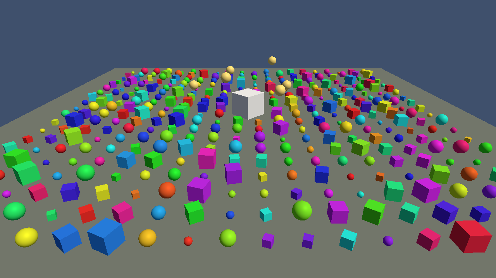

# game-engine

[](https://github.com/nikolagigic/game-engine/actions/workflows/ci.yml)

A small, readable, open-source 3D game engine written end-to-end in Rust.

The goal is an MVP that proves one architecture, not a feature list:

- **wgpu** renderer (Metal / Vulkan / DX12 / WebGPU from one code path)
- **winit** windowing and input
- **glam** math, **hecs** entity-component-system
- glTF meshes, instanced rendering, a fixed-timestep game loop
- Headless golden-image render tests so correctness is checked, not eyeballed
- An engine-native tool registry exposed over **MCP** (`engine-mcp`), so
  agents can build scenes, step the simulation, and look at rendered frames

## Demo



```sh
cargo run --release --example demo
```

A 20×20 field of cubes and spheres, a glTF-loaded pedestal with satellites
orbiting on the fixed-timestep simulation, a directional light, and frame
stats in the window title. Fly with W/A/S/D and E/Q; hold the right mouse
button to look around; Escape quits.

## Status

Pre-alpha. The workspace builds; subsystems land ticket by ticket.

## Build

```sh
cargo build
cargo check-all   # clippy with warnings denied
cargo test-all
```

Requires Rust 1.91 (pinned in `rust-toolchain.toml`).

## Layout

```
crates/engine/        the engine library
  src/<subsystem>.rs  one module per subsystem (see src/lib.rs)
  examples/           runnable demos
  tests/              integration + golden-image tests
crates/engine-mcp/    MCP server (stdio) over the engine's tool registry
```

## Using the engine from an agent

`engine-mcp` is an [MCP](https://modelcontextprotocol.io) server over stdio.
It runs one headless engine (default 512×288 offscreen target) and exposes
every tool in the engine's tool registry, named `<subsystem>.<verb>`
(`engine.info`, `engine.list_tools`, ...). New engine tools appear
automatically.

Register it with Claude Code from the repo root, either with the CLI:

```sh
claude mcp add engine -- cargo run -q -p engine-mcp
```

or by copying `.mcp.json.example` to `.mcp.json`. Then ask the agent to call
`engine.info`.

Options: `engine-mcp [--width W] [--height H] [--log-level L]`.
`--log-level` takes an `env_logger` filter and overrides `RUST_LOG`. Logs go
to stderr; stdout carries only JSON-RPC. To try it by hand:

```sh
cargo run -q -p engine-mcp <<'EOF'
{"jsonrpc":"2.0","id":1,"method":"initialize","params":{"protocolVersion":"2025-11-25","capabilities":{},"clientInfo":{"name":"me","version":"0"}}}
{"jsonrpc":"2.0","method":"notifications/initialized"}
{"jsonrpc":"2.0","id":2,"method":"tools/call","params":{"name":"engine.info","arguments":{}}}
EOF
```

## Contributing

See `CLAUDE.md` for architecture, conventions, and the definition of done.
Work is organised as tickets; each PR implements exactly one.
